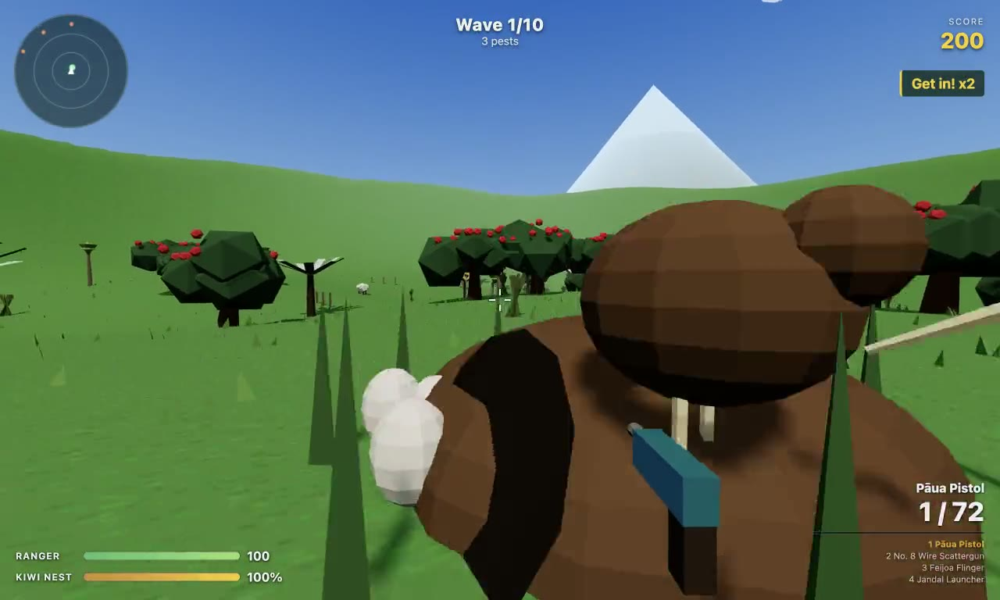

# KiwiScope

A Kiwiana first-person shooter. Introduced predators are coming for the kiwi eggs. You're the ranger standing between them and the burrow.

Hold out for ten waves of possums, stoats, rats and German wasps (plus the odd Mega Possum) and make the bush predator free.

Built with [Electron](https://www.electronjs.org/) and [three.js](https://threejs.org/). The textures, models and sound effects are all generated in code. The only bundled media is the voice lines on the ranger radio.

## Playthrough

[](docs/kiwiscope-playthrough.mp4)

▶️ **[Watch the playthrough (MP4, 1m36s, with radio voice lines)](docs/kiwiscope-playthrough.mp4)**

The clip is a scripted autopilot run. It plays wave 1, then skips ahead to the wave 5 Mega Possum. To re-record it, run `npm run demo` (it needs `ffmpeg`).

## Download

Grab the latest build from [Releases](https://github.com/jpcaparas/kiwiscope/releases/latest):

| Platform | File |
| --- | --- |
| macOS (Apple Silicon) | `KiwiScope-x.y.z-mac-arm64.dmg` |
| macOS (Intel) | `KiwiScope-x.y.z-mac-x64.dmg` |
| Windows | `KiwiScope-x.y.z-win-x64.exe` (installer) or `-win-x64.zip` (portable) |
| Linux | `KiwiScope-x.y.z-linux-x86_64.AppImage` or `-linux-x64.tar.gz` |

`SHA256SUMS.txt` on each release lists checksums for every file.

### First launch on unsigned builds

The builds aren't signed with an Apple or Microsoft certificate, so your OS will warn you the first time:

- **macOS:** open the DMG and drag KiwiScope to Applications. Then right-click the app and choose **Open**, and confirm. If macOS says the app is "damaged", clear the quarantine flag:
  ```bash
  xattr -cr /Applications/KiwiScope.app
  ```
- **Windows:** SmartScreen may show "Windows protected your PC". Click **More info**, then **Run anyway**.
- **Linux:** make the AppImage executable with `chmod +x KiwiScope-*.AppImage`, then run it.

## How to play

| Key | Action |
| --- | --- |
| `W` `A` `S` `D` | Move |
| Mouse | Look, left-click to shoot |
| `Shift` | Sprint |
| `Space` | Jump |
| `1`–`4`, mouse wheel, `Q` | Switch weapon |
| `R` | Reload |
| `M` | Mute |
| `Esc` | Pause (smoko) |

**Arsenal**

- **Pāua Pistol:** accurate, semi-auto, shell-inlaid.
- **No. 8 Wire Scattergun:** a short-range spread. Classic Kiwi ingenuity.
- **Feijoa Flinger:** fully automatic fruit.
- **Jandal Launcher:** lobs exploding jandals with splash damage.

**Pests**

- **Possum:** a tanky egg-raider.
- **Rat:** fast, fragile, and turns up in numbers.
- **Stoat:** quick, and goes for you if you get close.
- **German wasp:** flies straight at you.
- **Mega Possum:** a boss at waves 5 and 10.

**Tucker** (dropped by pests and left near the burrow between waves)

- **Lemon & Paeroa:** +30 health.
- **Mince and cheese pie:** +60 health.
- **Pineapple chews:** restocks ammo.
- **Pavlova:** repairs the nest.

You lose if your health or the nest's health hits zero. Clearing a wave earns a bonus for every point of nest health left.

The world is dotted with Kiwiana: pōhutukawa, ponga, tī kōuka and harakeke, a weatherboard bach, sheep, kiwi-crossing signs, a giant lemon-soda bottle, a giant carrot, a giant gumboot, and a Buzzy Bee.

## Development

Requires Node 24+.

```bash
npm install
npm start          # build the renderer and launch Electron
npm run dev        # Vite dev server (browser only, for fast iteration)
npm test           # unit tests (vitest)
npm run typecheck  # tsc --noEmit
npm run dist       # package installers for the current OS into release/
```

### Project layout

```
electron/            main process + preload (CommonJS, no build step)
src/
  main.ts            renderer entry
  game/
    Game.ts          composition root, main loop, phase table
    feedback.ts      event → HUD / audio / score wiring
    core/            Registry, EventBus, seeded RNG, math
    world/           terrain, sky, nest, prop registry (Kiwiana landmarks)
    player/          input, controller, collision
    enemies/         enemy registry, behaviour strategies, models, manager
    weapons/         Weapon base class (Template Method), Kiwiana weapons, registry
    combat/          hitscan, projectiles, terrain ray
    waves/           pure wave planning + spawner
    pickups/         pickup registry + manager
    audio/           procedural SFX (Web Audio) + radio voice player
    ui/              HUD, menus, slang phrase banks
  assets/voice/      pre-generated voice lines (mp3)
tests/               unit tests for the pure logic
scripts/             icon, voice and demo-video generation
docs/                playthrough video + poster
```

### Extending

Content lives in registries, so adding something means adding a file entry, not editing a switch:

- **Enemy:** add an `EnemyDef` in `src/game/enemies/registry.ts`. Pick a behaviour from `behaviours.ts` or write a new one, then use it in `planWave` in `waves/WaveDirector.ts`.
- **Weapon:** subclass `Weapon`, implement `onFire` and `buildViewModel`, then register it in `weapons/registry.ts`. Its slot number follows registration order. Add a matching sound recipe in `audio/Sfx.ts`, keyed by the weapon id.
- **Pickup:** register a `PickupDef` in `pickups/registry.ts`.
- **Landmark:** register a `PropDef` in `world/props.ts`, with either a fixed position or a scatter band.

### Voice lines

The radio lines in `src/assets/voice/` were generated with [ElevenLabs](https://elevenlabs.io) text-to-speech, using a New Zealand-accented voice from the ElevenLabs voice library. The script lives in `scripts/voice-lines.json`. To regenerate:

```bash
ELEVENLABS_API_KEY=... node scripts/generate-voices.mjs            # all lines
ELEVENLABS_API_KEY=... node scripts/generate-voices.mjs boss intro # specific lines
```

The key is read from the environment and never written to disk. The clips are committed, so nobody needs a key to build or play.

### Releasing

Push a `v*` tag. The [Release workflow](.github/workflows/release.yml) builds on native macOS, Windows and Linux runners, runs the type checks and tests, and publishes a GitHub Release with every installer and a `SHA256SUMS.txt`.

```bash
npm version minor   # bumps package.json and creates the tag
git push --follow-tags
```

## Security

See [SECURITY.md](SECURITY.md).

## Licence

[MIT](LICENSE) © JP Caparas. Lemon & Paeroa, pavlova and pineapple chews appear as generic Kiwi tucker. No trademarks or logos are used.
